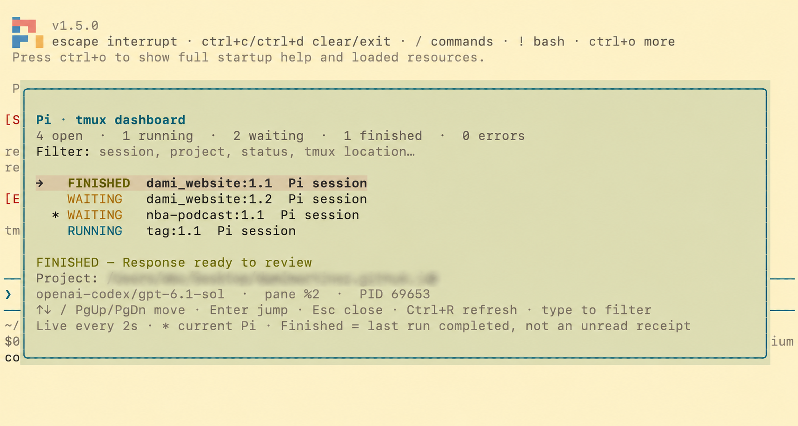

In my [previous post about Pi](/why-i-like-pi-coding-agent/), I wrote about why I like a coding agent that lets me build the harness I actually need. I ended with an idea: make it easier to work with multiple Pi sessions without leaving the terminal.

This is the first piece of that workflow. I built a Pi extension that shows the open Pi instances in my tmux server, tells me what they are doing, and lets me jump directly to one of them.

It is not a full agent orchestration system. It does not delegate tasks or send instructions to other agents. It is a small session navigator for a problem I kept running into: when several agents are working in different panes, where should I look next?



## Saved sessions are not the same as live sessions

Pi already has a session picker. I can use `/resume` to find a saved conversation and continue it. That is useful, but it answers a different question from the one I had.

When I have Pi open in several tmux windows, I want to know which instances are running now, which are waiting for input, and which have an answer ready to review. A conversation on disk is not necessarily open in a terminal, and an open terminal is not necessarily doing anything at this moment.

I could move through the tmux windows and check each one manually. That works until there are enough projects open that finding the right pane becomes work of its own.

The interface I wanted was simple: type `/dashboard`, see the open instances and their statuses, filter the list, and press Enter to go to one.

## A global extension instead of a Pi fork

I implemented the dashboard as a TypeScript extension in Pi's global extensions directory:

```text
~/.pi/agent/extensions/tmux-dashboard/
```

New Pi instances load it automatically. Instances that were already open need `/reload` before they can publish their detailed status. The extension registers the `/dashboard` command and uses Pi's lifecycle events and terminal UI components; it does not require a fork of Pi or a change to my tmux configuration.

The dashboard refreshes every two seconds. I can move with the arrow keys, type to filter by things like project, session name, status, or tmux location, and press Enter to jump to the selected pane. The current instance is marked with an asterisk. Giving a conversation a name with `/name` makes it easier to recognize in the list.

This is exactly the kind of extension I had in mind in the previous post: a small capability that fits the way I already work, rather than another application I have to keep open.

## Three sources of information

The interesting part was deciding what the dashboard should trust. A registry file alone does not prove a process is still running, and tmux alone cannot tell me whether Pi is generating an answer or waiting for a confirmation.

The implementation combines three sources:

1. **Pi lifecycle events** report what an instrumented instance is doing.
2. **The local process table** tells the dashboard which Pi processes are alive and where they sit in the process tree.
3. **tmux metadata** identifies sessions, windows, and panes and provides targets for navigation.

Each Pi instance publishes its own small local record. When I open the dashboard, it reads those records and joins them with the current process and tmux information. There is no separate daemon, database, web server, or model call involved in the dashboard itself.

The extension is split into an entry point for Pi integration, a core module for state and discovery, and a UI module for the overlay. Keeping discovery and state separate from rendering also makes them easier to test without an interactive terminal.

## Tracking activity without scraping the terminal

One possible approach would be to read the text displayed in each pane and look for a spinner or a question. I did not want the status to depend on how the terminal happens to render a response, so the extension listens to Pi's lifecycle events instead.

When an agent run starts, the instance reports **RUNNING**. Tool calls are tracked by call ID, which matters when more than one tool is active at a time. A blocking extension dialog takes priority and reports **WAITING**; once the dialog closes, the underlying activity can show through again. Context compaction is also reported as running activity.

The most subtle distinction was between a run ending and the agent actually settling. A low-level `agent_end` event is not always the end of the work: Pi may still retry, recover, or process a queued follow-up. Marking the instance as finished at that point could briefly show a misleading status.

Instead, the extension uses `agent_settled` as the final completion signal:

```typescript
// Simplified from the extension.
pi.on("agent_settled", (event, ctx) => {
  activity.settle(event.aborted);
  return publish(ctx);
});
```

The state machine also considers the last assistant error or abort outcome. A new run resets the previous outcome, so an earlier error does not permanently label a successful retry as failed.

## What the statuses mean—and what they do not

The dashboard uses a few deliberately simple flags:

| Status | Meaning |
| --- | --- |
| **WAITING** | The editor is ready for input, or a blocking extension dialog needs an answer. |
| **RUNNING** | Pi is generating, running tools, retrying, or compacting context. |
| **FINISHED** | The last agent run settled and its response is available to review. |
| **ERROR** | The last assistant response failed. |
| **STOPPED** | The run was cancelled, or the process is suspended. |
| **UNKNOWN** | A live status is unavailable or stale. |

There is an important qualification: **FINISHED is not a read receipt, and it does not mean the task succeeded**. It means the run reached a lifecycle boundary. Visiting the pane does not clear the flag, and the dashboard does not inspect an answer to decide whether it contains a question. A normal assistant message that asks me to make a decision can still appear as FINISHED.

A blocking extension prompt is different: Pi exposes that waiting state directly. The detail line helps distinguish it from an editor that is simply ready for input.

I prefer these honest limitations to a dashboard that guesses what I have read or whether the agent's work is correct.

## A small local registry

Each interactive Pi instance inside tmux writes a JSON record under `~/.pi/agent/tmux-dashboard/live/`, or the equivalent location in the configured Pi agent directory. The filename includes the process ID and a random UUID, so instances do not compete to rewrite one shared file.

The record contains metadata such as the pane and process IDs, session name, project directory, model, status, and heartbeat time. Events publish updates immediately, and a heartbeat refreshes the record every two seconds.

A few details make this more reliable than simply writing a JSON file:

- The extension writes to a temporary file and renames it, so readers do not see half-written records.
- Writes from the same instance are serialized, preventing an older heartbeat from overwriting a newer status.
- A heartbeat older than 15 seconds is treated as stale: a live process can still appear, but its status becomes **UNKNOWN**.
- Normal shutdown removes the record. If a crash leaves one behind, process and pane validation prevents that file alone from creating a live row.

The records do not contain prompts, answers, tool arguments, or tool output. They do contain potentially private metadata such as project paths and session names, so the registry uses restrictive directory and file permissions. This is still local code running with my user permissions, not a security boundary between extensions.

## Finding the pane and getting there

To find open instances, the dashboard asks tmux for its panes and reads the local process table. It checks whether each recognized Pi process belongs under a pane's process tree, then matches any registry record against the current socket, pane, and process.

That distinction is useful when an older Pi instance has not reloaded the extension yet. The dashboard can still discover and navigate to the process, but it shows **UNKNOWN** instead of inventing a status. After `/reload`, that instance can start publishing detailed activity.

When I select a row, the extension checks again that the pane exists and the Pi process is still alive beneath it. It then switches the attached tmux client to the target session, selects the window, and selects the pane. It uses tmux IDs rather than display names, and invokes commands with argument arrays instead of building shell-interpolated strings.

There is one tmux limitation worth mentioning: if multiple clients are viewing the same source session, the pane environment does not unambiguously identify which person invoked the dashboard. The current implementation chooses the most recently active attached client viewing that session. If there is no suitable attached client, it reports an error instead of switching an unrelated one.

## Making the overlay pleasant to use

The first version established that discovery and navigation worked, but using it revealed some smaller interface problems. The overlay blended into the transcript behind it, and the filter's cursor competed visually with the selected row.

I added a rounded border, padding, an opaque theme-tinted background, and a selected-row highlight. The filter still uses Pi's input component for keyboard editing, but the dashboard renders its value without a visible cursor. Typing and editing continue to work; the normal Pi editor is unchanged.

There are a few less visible details too. Selection follows the pane/process identity rather than the row index, so a refresh does not unexpectedly move it to a different session. Refreshes do not overlap, and a failed discovery clears stale choices instead of presenting them as current. The layout also accounts for terminal width, Unicode, and the available height.

None of these decisions changes the core idea, but together they make the difference between a proof of concept and something I want to use throughout the day.

## Testing the workflow

The extension has core tests for state transitions, process discovery, stale records, registry permissions, and cleanup. Runtime and UI tests use Pi's extension loader and terminal UI library to exercise filtering, selection, resizing, themes, lifecycle updates, and the cursor-free panel.

I also tested the actual navigation with two Pi interfaces in an isolated tmux server. The smoke test opens the dashboard, filters for the other instance, selects it, and verifies that the test client reaches the exact target window and pane. It then checks that the registry entry disappears when Pi exits. The test runs offline, without model calls or changing my existing tmux clients.

The validation environment was macOS, Pi 1.5.0, tmux 3.7b, and Node.js 23. The implementation relies on tmux and a Unix-style process table; I have not verified equivalent behavior on other operating systems.

## A smaller first step toward managing multiple agents

This dashboard only covers the current tmux server. It does not automatically collect sessions from remote machines, SSH connections, containers, or other tmux servers. It also does not show closed historical conversations, acknowledge answers as read, or send commands to other agents.

Those boundaries are intentional. The first problem was not how to control a fleet of agents; it was how to see the work already happening in my terminal and get back to the right place quickly.

What I like about the result is the separation of concerns: Pi events describe activity, the operating system confirms that a process exists, and tmux provides the location and navigation. When one of those sources cannot provide a reliable answer, the dashboard can say **UNKNOWN** rather than guessing.

The goal was not to add another place to manage my work. It was to make the place where I already work tell me where my attention is needed.

I have not made this extension public yet, but if you would like to try it, send me an email or a DM on LinkedIn.

---

**Like this content?** Subscribe to my [newsletter](https://damianmartinezcarmona.substack.com/) to receive more tips and tutorials about AI, Data Engineering, and automation.
